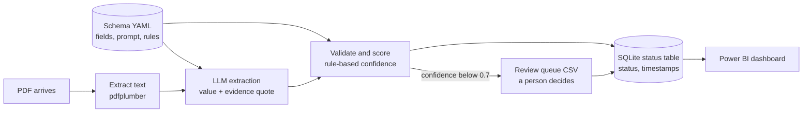
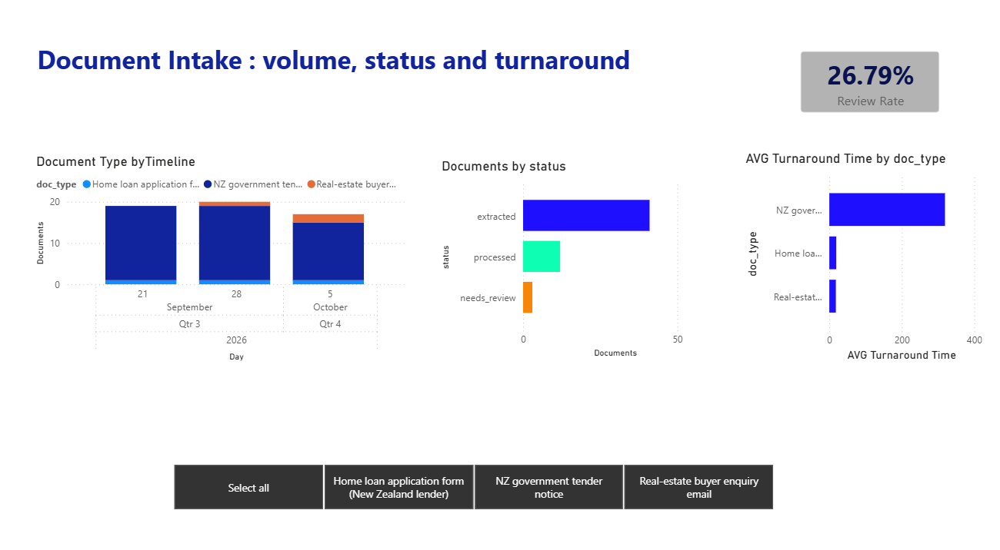

# AI Document Intake & Workflow Visibility

## 1. The problem

A lender or adviser receives applications as PDFs in whatever layout the sender used. Someone re-keys
the name, the income and the loan amount into a system, and nobody can say how many applications are
waiting, which ones are stuck, or how long they take. This project reads semi-structured PDFs with an
LLM, puts every extracted field next to the evidence for it, sends doubtful fields to a person, and
records each document's status and timestamps so the queue is visible.

The fields to extract live in a YAML file, not in code. Swapping the file points the same pipeline at
a different document type.

## 2. Architecture



Confidence is computed by rules, not reported by the model:

| Case | Score |
| --- | --- |
| Value passes validation and its evidence quote (or the value itself) is in the PDF text word for word | 1.0 |
| Value passes validation but cannot be found in the text | 0.6 |
| Value fails validation (bad date, wrong format, not an allowed option) | 0.3 |
| Required field is empty | 0.0 |
| Optional field is empty: 1.0 if the document never mentions it, 0.5 if it does | 1.0 or 0.5 |

Any field under 0.7 goes to the review queue, and its document is marked `needs_review`.

## 3. Accuracy

Measured on 10 real tender notices against labels fixed before extraction ran.

| Field | Correct | Total | Accuracy | |
| --- | --- | --- | --- | --- |
| agency | 10 | 10 | 100% |  |
| title | 10 | 10 | 100% |  |
| reference | 10 | 10 | 100% |  |
| close_date | 10 | 10 | 100% |  |
| category | 10 | 10 | 100% |  |
| region | 10 | 10 | 100% |  |
| contact_name | 10 | 10 | 100% |  |
| **overall** | 70 | 70 | 100% | |

Model: `gpt-6-luna`. Extraction run: 2026-10-09. Full report: [`output/accuracy_report.md`](output/accuracy_report.md).

Read this number with care:

- It is 10 documents from one website. Every GETS notice page uses the same template, so this is an
  easy test. One error would have moved a field by 10 points.
- The labels were drafted by a rule-based script (no LLM) and then checked by hand against each PDF;
  0 of 70 cells needed correction. The 10 documents were drawn at random (seed 42) and never used for
  prompt tuning; 5 other documents were used for that.
- There is no gold set for the loan or enquiry documents. On those 6, reading each against its source,
  the model missed one value that was present (a loan purpose typed beside tick-box labels) and left
  several awkwardly written values empty for review. See section 4.

## 4. Re-point demo: three document types, one config change

| Document type | Schema file | Documents | Extracted cleanly | Sent to review |
| --- | --- | --- | --- | --- |
| NZ government tender notice | `config/schema_tender.yaml` | 50 | 38 | 12 |
| Home loan application form | `config/schema_loan_application.yaml` | 3 | 1 | 2 |
| Real-estate buyer enquiry email | `config/schema_realestate_lead.yaml` | 3 | 2 | 1 |

The command is the same each time; only the YAML file changes:

```bash
python -m src.extract --schema config/schema_tender.yaml
python -m src.extract --schema config/schema_loan_application.yaml
python -m src.extract --schema config/schema_realestate_lead.yaml
```

Sample output for each: [tender](docs/repoint_tender.md), [loan](docs/repoint_loan.md), [enquiry](docs/repoint_lead.md).

The pipeline code was not edited between the tender run and the other two. This prints nothing:

```bash
git diff --stat b42e304 d93d047 -- src/extract.py src/validate.py src/store.py src/review.py src/llm.py src/schema.py
```

A test also fails the build if any field name from any schema file appears in `src/`.

What the review queue caught on the loan and enquiry documents: three boxes left blank on a form, an
amount written as "350-360k", an income of "about 65k", an email written "pat(at)example.com", a phone
number too short to be real, and the missed loan purpose. Values the model converted correctly
included "1st March 1978", "01/02/27" and a budget of "1.2m".

## 5. Dashboard



**The dates and turnaround times in this image are simulated.** All 56 documents were really received
on one day, which makes a chart over time a single bar, so `dashboard/simulate_timings.py` spreads the
arrival and processing times over three working weeks to show the layout. The document counts, the
statuses (41 extracted, 12 processed, 3 needing review) and the 26.79% review rate are real pipeline
output. The real timings are in `dashboard/applications.csv`: about 1 hour 40 minutes from receipt to
extraction and about 3 hours 5 minutes for the 12 documents that went through review, as clock time
in a single demo session, not a figure for live operations.

Power BI file: [`dashboard/intake.pbix`](dashboard/intake.pbix). Build notes: [`dashboard/BUILD.md`](dashboard/BUILD.md).

## 6. How to run

```bash
python3 -m venv .venv && source .venv/bin/activate     # Python 3.11+
pip install -r requirements.txt
cp .env.example .env                                   # fill in provider, model and API key
python -m pytest -q                                    # 22 tests, offline, no key needed

python -m src.fetch_docs --print                       # save the tender pages in data/sources.md as PDFs
python -m src.extract --schema config/schema_tender.yaml
python -m src.store sync                               # build the status table
python -m src.review build                             # write output/review_queue.csv
#   fill reviewer_action (accept / correct / blank) in the CSV, then:
python -m src.review apply
python -m src.evaluate --schema config/schema_tender.yaml
python -m src.export_bi                                # write dashboard/applications.csv
```

Any OpenAI-compatible or Anthropic model works; the provider and model are set in `.env`. Responses
are cached on disk, so a rerun costs nothing, and a call cap in `.env` stops runaway spend. The whole
project used 56 API calls.

## 7. Known limitations

- Accuracy is measured on 10 documents from a single page template. It is not evidence of accuracy on
  varied real-world documents.
- No OCR. A scanned PDF with no text layer goes straight to review.
- The confidence rules catch missing evidence and bad formats. They do not catch a well-formed value
  quoted from the wrong place in the document.
- An empty optional field is flagged whenever its keyword appears in the document. On printed forms
  the keyword is always there, so every blank box is sent to a person.
- Turnaround comes from one batch demo run, and the dashboard image uses simulated timings.

## 8. Data statement

| Documents | Real or fictional | Source |
| --- | --- | --- |
| 50 tender notices | Real and public | Notice pages on the NZ Government Electronic Tenders Service (gets.govt.nz), saved as PDF on 2026-10-09. Every URL and file hash is in [`data/sources.md`](data/sources.md) |
| 3 loan applications | Real blank form, fictional content | First Credit Union's public home loan application form, filled by script with made-up applicants (Jane Example, John Sample, Pat Placeholder) and stamped as fictional on every page |
| 3 real-estate enquiries | Fictional | Written by `src/make_fictional_leads.py` |

No real personal or financial data is used anywhere. Real loan applications hold a person's income,
debts and identity details; under the NZ Privacy Act 2020 they could not be obtained or published.

No PDF is committed to this repository. The tender pages and the lender's form are other people's
documents, so the repository holds the list of sources and the scripts that fetch or generate them.
